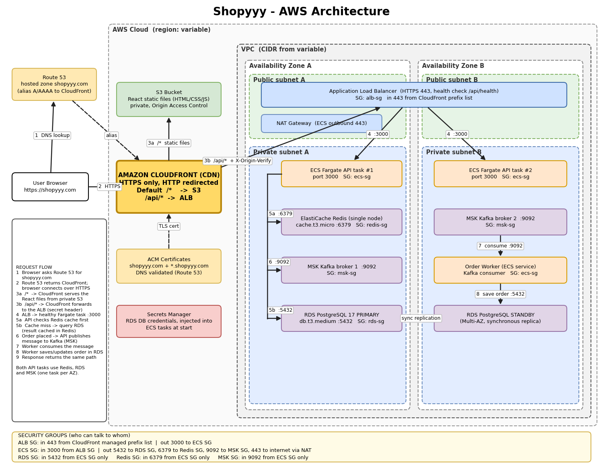
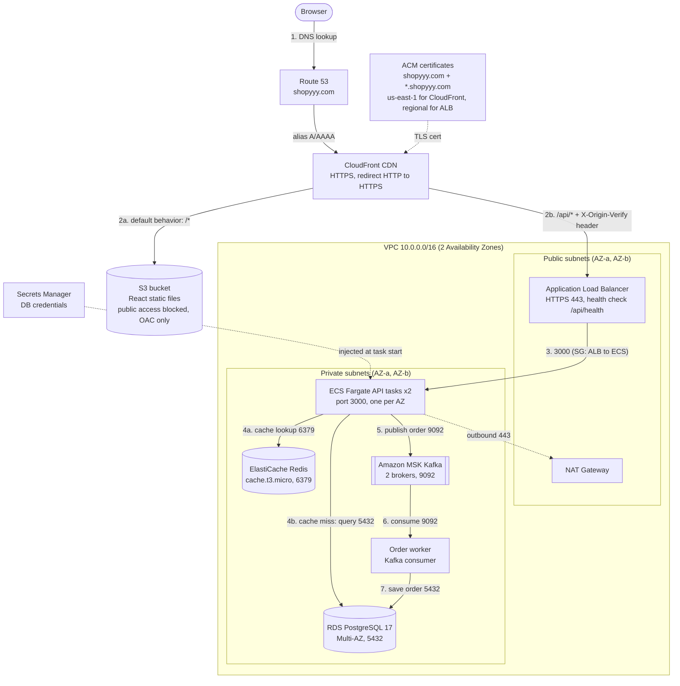

# Shopyyy: AWS Infrastructure (Terraform)

Infrastructure-as-code for the **Shopyyy** e-commerce platform: a React frontend served from S3 and CloudFront, a containerised API on ECS Fargate, PostgreSQL on RDS, Redis for caching and Kafka (MSK) for asynchronous order processing.

- **Part 1:** architecture diagram and request flow (below)
- **Part 2:** modular Terraform in `modules/` and `envs/dev/`, with unit tests for every module

---

## Part 1: Architecture



Editable source: [`docs/architecture.drawio`](docs/architecture.drawio) (open at app.diagrams.net). A text-based Mermaid version of the same design follows.



Mermaid source: [`docs/architecture.mmd`](docs/architecture.mmd). Paste it into <https://mermaid.live> to export PNG or SVG.

### Request flow

**Browsing the site**
1. The browser resolves `shopyyy.com` through **Route 53**, which returns CloudFront (alias record).
2. **CloudFront** terminates TLS with the **ACM** certificate and redirects HTTP to HTTPS.
3. For `/*`, CloudFront fetches static files from **S3** through Origin Access Control. The bucket is private.

**Calling the API** (`/api/*`)
4. CloudFront forwards the request, uncached, to the **ALB** over HTTPS and adds a secret `X-Origin-Verify` header.
5. The ALB (public subnets) accepts only traffic from the CloudFront prefix list that carries the header. It forwards to a healthy **Fargate** task on port 3000 in a private subnet.
6. The API checks **Redis** first. On a cache miss it queries **RDS PostgreSQL** and writes the result back to Redis.
7. The response returns along the same path.

**Placing an order**
8. The API saves the order in RDS and publishes a message to **MSK Kafka**, then returns immediately.
9. The **worker** service consumes the message and finishes processing in the background (the order status is updated in RDS).

### Security groups: who may talk to whom

| Security group | Inbound | Outbound |
|---|---|---|
| **ALB** | 443 from the CloudFront managed prefix list | 3000 to ECS SG |
| **ECS** | 3000 from ALB SG | 5432 to RDS SG, 6379 to Redis SG, 9092 to MSK SG, 443 to internet via NAT (image pulls, AWS APIs) |
| **RDS** | 5432 from ECS SG | none |
| **Redis** | 6379 from ECS SG | none |
| **MSK** | 9092 from ECS SG | none |

Every rule references another security group (or the CloudFront prefix list). There are no CIDR-based ingress rules. Each rule is a standalone `aws_vpc_security_group_*_rule` resource, which avoids circular dependencies between the groups.

---

## Part 2: Terraform

### Layout

```
.
├── bootstrap/            # one-off: creates the S3 bucket for remote state
├── envs/
│   └── dev/              # root module: wires modules together (add staging/prod the same way)
├── modules/
│   ├── network/          # VPC, subnets, IGW, NAT, route tables
│   ├── security/         # all security groups and rules
│   ├── dns_acm/          # Route 53 zone, ACM certs (us-east-1 + regional), DNS validation
│   ├── dns_records/      # alias records (site -> CloudFront, api-origin -> ALB)
│   ├── s3_frontend/      # private bucket + CloudFront-only bucket policy
│   ├── cloudfront/       # 2 origins, OAC, /api/* behavior, HTTPS
│   ├── alb/              # ALB, target group, HTTPS listener, origin-header rule
│   ├── ecs/              # cluster, task definition, service(s), IAM, logs
│   ├── rds/              # PostgreSQL 17, Multi-AZ, Secrets Manager credentials
│   ├── redis/            # ElastiCache Redis, single node
│   └── msk/              # Kafka, 2 brokers
└── .github/workflows/    # CI: fmt, unit tests, validate, tflint, checkov
```

Each module has `variables.tf`, `main.tf`, `outputs.tf` and a `tests/*.tftest.hcl` file.

### Requirement checklist

| Requirement | Where |
|---|---|
| VPC CIDR as variable, 2 public + 2 private subnets in different AZs (`cidrsubnet`), IGW, NAT, route tables | `modules/network` |
| Route 53 zone, ACM for `shopyyy.com` + `*.shopyyy.com`, DNS validation | `modules/dns_acm` |
| CloudFront: S3 + ALB origins, ACM cert, `/api/*` to ALB, rest to S3 | `modules/cloudfront` |
| S3 with all public access blocked, OAC, CloudFront-only bucket policy | `modules/s3_frontend` |
| ALB in public subnets, target group :3000, health check `/api/health`, listener :443 | `modules/alb` |
| ECS Fargate, placeholder image, 2 tasks, DB/Redis config via env vars and Secrets Manager | `modules/ecs` |
| RDS PostgreSQL 17, `db.t3.medium`, Multi-AZ, private, credentials in Secrets Manager, subnet group | `modules/rds` |
| ElastiCache Redis `cache.t3.micro`, single node, subnet group, ECS-only access | `modules/redis` |
| MSK, 2 brokers across 2 AZs, private, ECS-only access | `modules/msk` |
| Security groups exactly as specified | `modules/security` |
| `variables.tf` everywhere, outputs (CloudFront, ALB, RDS, Redis), S3 backend, Environment + Project tags, no hardcoded values | `envs/dev`, `bootstrap` |

### Design decisions

- **ECS Fargate (not EC2 or EKS).** There are no servers to patch, and it is far simpler than EKS for a single API plus a worker. Capacity is per task and billing is pay-per-use. If the platform grows into dozens of services, EKS can be revisited.
- **Two ACM certificates.** CloudFront only accepts certificates from `us-east-1`. The ALB needs its own in the workload region. A second AWS provider alias handles this. Both certificates use the same DNS validation records.
- **The ALB cannot be bypassed.** It is protected in two layers: the security group allows only the CloudFront prefix list, and the listener returns 403 unless the request carries the secret `X-Origin-Verify` header (a random value generated by Terraform). CloudFront reaches the ALB through `api-origin.shopyyy.com`, covered by the wildcard certificate, so TLS is verified end to end.
- **Database credentials.** RDS generates and stores the master password in Secrets Manager (`manage_master_user_password`). The ECS execution role is allowed to read only that secret, and ECS injects `DB_USERNAME` and `DB_PASSWORD` at task start. No password is ever in code, state or task-definition environment variables.
- **Redis encrypted in transit.** The URL is `rediss://` (TLS) and storage is encrypted at rest.
- **Remote state.** S3 backend with versioning, encryption and native lockfile locking (`use_lockfile`, Terraform 1.10+). Bucket, key and region are passed at init time, so nothing is hardcoded.
- **NAT cost vs availability.** `single_nat_gateway = true` (dev default) uses one NAT. Set it to `false` for one NAT per AZ in production.
- **Fargate AZ spread.** Tasks run in both private subnets, and the Fargate scheduler balances them across AZs.

### Known trade-offs (deliberate)

- **MSK on port 9092 is plaintext.** This follows the brief. In production, set `msk_client_broker_encryption = "TLS"` for TLS plus IAM authentication on port 9098. The security group, MSK config and bootstrap string all follow that one variable.
- **ALB-only HTTPS.** The ALB SG allows only 443 from CloudFront, so there is no port 80 listener.
- **CloudFront prefix list and SG quota.** The managed prefix list counts against the security group rule quota (about 55 entries). Request a quota increase if you also need many other rules on the ALB SG.
- **Placeholder image.** `hashicorp/http-echo` answers 200 on every path, including `/api/health`, so the stack goes healthy before the real app exists. Replace `container_image` (and clear `container_command`) with your ECR image.

---

## Testing

Tests are written with the native `terraform test` framework against a **mock AWS provider**, so they run in seconds, need no credentials and cost nothing.

```bash
# unit tests, one module at a time
cd modules/network && terraform init -backend=false && terraform test

# all modules
for d in modules/*/; do (cd "$d" && terraform init -backend=false -input=false && terraform test); done
```

What the tests assert, for example:

| Module | Assertions |
|---|---|
| network | 2 public + 2 private subnets, different AZs, no overlapping CIDRs, CIDR from variable, NAT count, required tags, invalid CIDR rejected |
| security | each data store allows only its port, from an SG (never a CIDR), ALB uses the CloudFront prefix list, nothing opens `0.0.0.0/0` inbound |
| rds | Multi-AZ, not public, engine 17, `db.t3.medium`, password managed by Secrets Manager, storage encrypted |
| s3_frontend | all 4 public-access-block settings on, policy allows only the CloudFront principal for the given distribution |
| alb | health check `/api/health`, target port 3000, HTTPS :443, 403 default action, header rule |
| ecs | 2 tasks, Fargate, no public IP, port 3000, DB password from Secrets Manager (never plain env var) |
| redis / msk / cloudfront / dns_acm | node type and single node, encryption, 2 brokers across 2 subnets, two origins, `/api/*` behavior, redirect to HTTPS, cert covers apex and wildcard |

Other checks (also run in CI, see `.github/workflows/terraform-ci.yml`):

```bash
terraform fmt -check -recursive
cd envs/dev && terraform init -backend=false && terraform validate
tflint --recursive
checkov -d . --framework terraform
```

---

## Deploying

```bash
# 1. Create the remote state bucket (once)
cd bootstrap
terraform init
terraform apply -var="state_bucket_name=<globally-unique-name>"

# 2. Deploy the environment
cd ../envs/dev
cp backend.hcl.example backend.hcl        # fill in the bucket name
terraform init -backend-config=backend.hcl
terraform plan -out=tfplan
terraform apply tfplan
```

**Domain note.** `terraform apply` creates the Route 53 hosted zone and then waits for ACM validation. Before validation can complete, the registrar's name servers must point to the `name_servers` output. For a real deployment, create the zone first with `terraform apply -target=module.dns_acm.aws_route53_zone.this`, update the registrar, then run the full apply. `shopyyy.com` is a fictional domain for this exercise, so `terraform plan` is the intended end point.

**Upload the frontend:** `aws s3 sync build/ s3://$(terraform output -raw frontend_bucket)`

## Outputs

`cloudfront_domain_name`, `alb_dns_name`, `rds_endpoint`, `redis_endpoint`, plus `kafka_bootstrap_brokers`, `db_secret_arn`, `name_servers` and `frontend_bucket`.

## What I would add next

CI/CD for the application image (ECR + GitHub Actions deploy), ECS autoscaling on CPU and request count, AWS WAF on CloudFront, CloudWatch alarms and dashboards, per-environment `staging` and `prod` roots reusing the same modules, and Kafka TLS + IAM authentication enabled by default.
